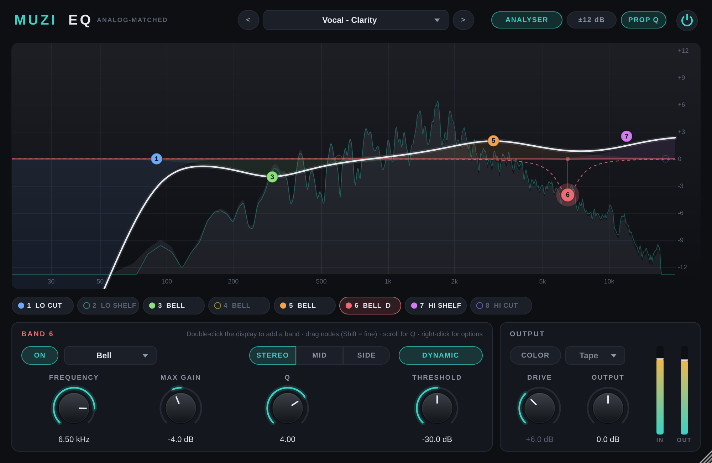
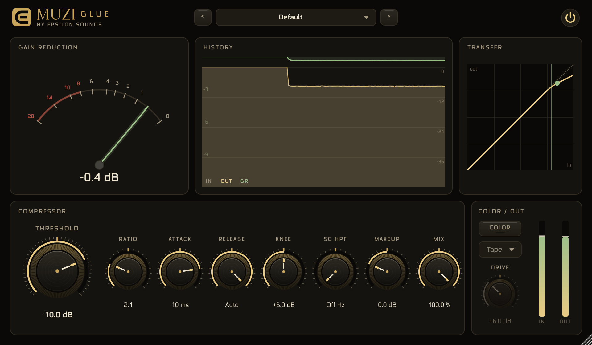

# Muzi EQ + Muzi Glue v0.1

Two JUCE plugins (VST3 / AU / Standalone) built on the Muzi Tame framework. Clean by default, with an optional **Color** stage on both.

| Muzi EQ | Muzi Glue |
|---|---|
|  |  |

## Open and build (Mac)
Everything is inside this folder, including JUCE 9.0.5 (in `JUCE/`), so nothing else needs downloading.

1. Double-click **`MuziEQ/MuziEQ.jucer`**. It opens in Projucer with all the code in.
2. Click the Xcode button at the top (Save and Open in IDE).
3. In Xcode choose the scheme **Muzi EQ - All**, then Product > Build (a Release build runs lightest).
4. Xcode copies the plugins to `~/Library/Audio/Plug-Ins/VST3/` and `Components/` (AU). Rescan in your DAW.
5. Same for **`MuziGlue/MuziGlue.jucer`**.

You can also skip Projucer and open `MuziEQ/Builds/MacOSX/Muzi EQ.xcodeproj` directly. Projects: JUCE 9.0.5, macOS 12.0 target, Apple Silicon + Intel (Xcode standard architectures), VST3 + AU + Standalone. Windows: `Builds/VisualStudio2022`.
Keep the folder structure as is: both projects use the shared `Source/` and `JUCE/` folders.

CMake alternative: `cmake -B build -DCMAKE_BUILD_TYPE=Release && cmake --build build --config Release` (downloads JUCE 9.0.5). Test tools: add `-DMZ_BUILD_TESTS=ON`.

---

## Muzi EQ

8 bands. Every curve is **analog-matched**: poles mapped exactly from the analog prototype, numerator solved so the digital response equals the analog one at DC, Nyquist and the band frequency (Vicanek, "Matched Second Order Digital Filters", 2016). Standard digital EQs (bilinear / RBJ cookbook) squeeze curves toward the top of the spectrum; these don't.

**Band types:** Bell, Low Shelf, High Shelf, Tilt, Low Cut, High Cut (6, 12, 18, 24, 36, 48 dB/oct Butterworth), Notch.

| Control | What it does |
|---|---|
| Display | Drag a node: frequency and gain (Shift = fine). Scroll: Q. Double-click a node: on/off. Double-click empty space: add a band. Right-click a node: type, slope, channel, dynamic |
| Frequency / Gain / Q | Per band. Shelves: Q above 0.71 adds the classic bump and dip. Cuts: Q sets the resonance at the corner |
| Stereo / Mid / Side | Each band can work on both channels, only the centre, or only the sides. The display then shows a MID (white) and a SIDE (amber) curve |
| Dynamic | The band only moves when its part of the spectrum gets louder than **Threshold**; Gain becomes the most it can move (3:1 above threshold, 6 dB soft knee, 3 ms / 100 ms). Bells and shelves |
| Prop Q | Proportional Q: Q is exact at ±6 dB; smaller moves are wider, bigger moves narrower, like classic console EQs. On by default |
| Color / Drive / Character | Optional saturation after the EQ, 4x oversampled. Tape = odd harmonics, rounds peaks. Tube = adds even harmonics. Quiet parts keep their level. Adds 6 samples of latency (reported) |
| Output | Output level |
| Analyser | Off / input / input + output. Tilted 4.5 dB/oct, so a balanced mix reads roughly flat |
| ±12 / ±24 | Display range |

Presets: Flat, Master - Tame Forward Mids, Master - Dynamic Mid Control, Master - Air & Weight, Mix Bus - Smile, Vocal - Clarity (with a dynamic de-ess band), 808 - Clean Up, Kick - Punch, Side - Mono Bass Wider Top, Tilt - Brighter.

## Muzi Glue

Feed-forward bus compressor after Giannoulis, Massberg & Reiss, "Digital Dynamic Range Compressor Design" (JAES 2012): stereo-linked detection, soft-knee gain computer in the log domain, smooth peak detector on the gain reduction.

| Control | What it does |
|---|---|
| Threshold | Lower it until the needle shows the reduction you want (1-4 dB glues a mix) |
| Ratio | 1.5:1, 2:1, 3:1, 4:1, 10:1 |
| Attack | 0.1, 0.3, 1, 3, 10, 30 ms. Slower lets drum hits through |
| Release | 0.1, 0.3, 0.6, 1.2 s, or **Auto**: recovers in ~60 ms after a single hit and ~1 s after sustained loud passages, which avoids pumping |
| Knee | 0-12 dB. Higher = gentler start of compression |
| SC HPF | Sidechain high-pass (24 dB/oct): stops kick and 808 from driving the compressor. 60-120 Hz on a mix bus. Off at 20 Hz |
| Makeup | Gain after compression |
| Mix | Below 100 % = parallel compression |
| Color / Drive / Character | Same Color stage as the EQ |

Display: gain-reduction needle with peak hold, 5-second history (IN grey, OUT teal, GR amber on its own 0-12 dB scale), transfer curve with the live operating point.

Presets: Default, Mix Bus - Classic Glue, Mix Bus - Gentle, Master - 1 dB of Glue, Drum Bus - Punch, Drum Bus - Parallel Smash, Vocal Bus - Smooth, Pump. Thresholds are starting points: set Threshold by the needle.

---

## Measured

**Curve accuracy** (max error vs the analog curve, 20 Hz-20 kHz, `tests/dsp/curve_test.cpp`)

| Filter | Muzi EQ 44.1 / 48 / 96 kHz | Bilinear (RBJ) 44.1 / 48 / 96 kHz |
|---|---|---|
| Bell 10 kHz +6 dB Q1 | 0.41 / 0.37 / 0.12 dB | 1.96 / 1.68 / 0.45 dB |
| Bell 16 kHz +6 dB Q1 | 0.82 / 0.63 / 0.13 dB | 4.23 / 3.35 / 0.49 dB |
| Bell 16 kHz -12 dB Q4 (hardest case) | 3.43 / 2.35 / 0.33 dB | 5.89 / 4.88 / - dB |
| High shelf 10 kHz +4 dB | 0.08 / 0.06 / 0.00 dB | |
| Bells and shelves below 5 kHz | ≤ 0.15 dB | |

**Through the built VST3 (headless host)**
- EQ impulse response matches the designed curve within 0.03 dB from 40 Hz up (four bands incl. an 18 dB/oct cut).
- Mid band on a pure side signal: 0.00 dB change; Side band on mono: 0.00 dB.
- Automation: a +12 dB Q4 bell swept 100 Hz → 10 kHz in 0.5 s, bands switched on/off and a type change mid-signal: no clicks.
- Dynamic bell (-6 dB max, threshold -20): quiet tone 0.0 dB, 6 dB over threshold -3.7 dB, loud tone -6.0 dB.
- Glue timing: set 10 ms / 100 ms → measured 10.0 / 100.0 ms. Auto release: 60 ms after a 50 ms burst, ~1 s after 3 s of compression.
- Both plugins: identical output at 64- and 1024-sample buffers; state save/restore round-trips; zero latency unless Color is on (6 samples, reported; bypass stays aligned).
- Color, 7 kHz tone at -1 dBFS, Drive 12 dB: worst aliasing product -84 dB.
- CPU (one x86 core, stereo 48 kHz): EQ 8 bells 0.16 %, 6 dynamic bells + two 48 dB/oct cuts 0.58 %, Glue 0.23 %.

**On JOJO** (EQ -2 dB bell at 1.5 kHz Q0.7 + 22 Hz cut → Muzi Tame → Glue 2:1, -14 dB, 30 ms, Auto, SC 90 Hz → limiter at -1 dBTP): about 1.2 dB median glue; the 1-2.5 kHz build-up drops by ~1 dB; PLR 7.9 → 9.3 dB; true peak -1.1 dBTP; -10.4 LUFS (the original is -9.1 LUFS / -0.4 dBTP).

## Known limits (v0.1)
- Narrow, deep cuts above ~14 kHz at 44.1/48 kHz still deviate from the analog curve (up to 3.4 dB worst case; bilinear: 5.9 dB). An oversampled HQ mode would fix it.
- No linear-phase mode yet. Dynamic bands have fixed timing (3 ms / 100 ms) and ratio (3:1).
- Glue's detector is peak-based: on a steady sine it reduces about 1 dB less than the drawn static curve at high levels (13.8 vs 15 dB at 20 dB over threshold, 4:1). The needle shows the real reduction.
- Color at high Drive is strong (12 dB on a -6 dBFS tone: 3rd harmonic at -16 dB). Start around 3-6 dB.
- Built and tested on Linux (CMake and the Projucer-generated makefile, JUCE 9.0.5); the Xcode project comes from the same .jucer files but hasn't been run on a Mac here.

## Layout
- `MuziEQ/MuziEQ.jucer`, `MuziGlue/MuziGlue.jucer` - Projucer projects (+ generated `Builds/` and `JuceLibraryCode/`)
- `JUCE/modules` - JUCE 9.0.5, bundled
- `Source/shared/MatchedFilters.h` - analog-matched filter designs, no JUCE
- `Source/eq/MuziEqEngine.h`, `Source/glue/MuziGlueEngine.h` - DSP engines, header-only, no JUCE, no allocation after `prepare()`
- `Source/shared/ColorStage.h` - oversampled saturation (JUCE dsp)
- `Source/shared/MuziWidgets.h`, `Source/shared/MuziLookAndFeel.h` - knob, meters, palette (shared with Muzi Tame)
- `Source/eq/Eq*`, `Source/glue/Glue*` - processors and editors
- `tests/dsp/` - curve accuracy, engine tests, CPU benchmark (`g++ -O2 -std=c++17 engine_test.cpp`)
- `tests/host/HostTest.cpp` - headless VST3 host (`MuziHostTest plugin.vst3 in_dir out_dir "Band 5 Gain=-2" --rate 44100`)
- `tests/snapshot/` - render each editor to PNG with audio running
